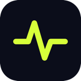

<p align="center">
  
</p>

<h1 align="center">F-Pulse App iOS SDK</h1>

<p align="center">
  <strong>Collect user feedback in your iOS and macOS apps with ease</strong>
</p>

<p align="center">
  <a href="https://swift.org"></a>
  <a href="https://developer.apple.com/ios/"></a>
  <a href="https://developer.apple.com/macos/"></a>
  <a href="https://swift.org/package-manager/"></a>
  <a href="LICENSE"></a>
</p>

<p align="center">
  <a href="#installation">Installation</a> •
  <a href="#quick-start">Quick Start</a> •
  <a href="#usage">Usage</a> •
  <a href="#swiftui-view">SwiftUI View</a> •
  <a href="#api-reference">API Reference</a>
</p>

---

## Features

- **Simple Integration** — Get started with just 2 lines of code
- **SwiftUI Ready** — Pre-built feedback UI with `.feedbackSheet()` modifier
- **Async/Await** — Modern concurrency support for iOS 15+
- **Automatic Metadata** — Captures device info, OS version, and app details
- **Lightweight** — No external dependencies, pure Swift

---

## Installation

### Swift Package Manager

Add FeedbackPulse to your project in Xcode:

1. Go to **File → Add Package Dependencies**
2. Enter the repository URL:
   ```
   https://github.com/Fpulse-App/fpulse-ios-sdk
   ```
3. Select version **1.0.0** or later
4. Click **Add Package**

**Or** add it to your `Package.swift`:

```swift
dependencies: [
    .package(url: "https://github.com/Fpulse-App/fpulse-ios-sdk", from: "1.0.0")
]
```

---

## Quick Start

### 1. Configure the SDK

```swift
import FeedbackPulse

// In AppDelegate or @main App
FeedbackPulse.configure(apiKey: "fp_your_api_key")
```

> Get your API key from the [F-Pulse App dashboard](https://fpulse.app/dashboard/projects) (Projects page)

### 2. Collect Feedback

```swift
// Simple one-liner
FeedbackPulse.submit(sentiment: .positive)

// With comment
FeedbackPulse.submit(sentiment: .negative, comment: "App crashes on login")
```

That's it! Feedback will appear in your dashboard.

---

## Usage

### Submit with Callback

```swift
FeedbackPulse.submit(
    sentiment: .positive,
    comment: "Love this app!",
    metadata: ["screen": "home", "user_id": "12345"]
) { result in
    switch result {
    case .success(let response):
        print("Submitted: \(response.feedbackId)")
    case .failure(let error):
        print("Error: \(error.localizedDescription)")
    }
}
```

### Submit with Async/Await (iOS 15+)

```swift
do {
    let response = try await FeedbackPulse.submit(
        sentiment: .positive,
        comment: "Great experience!"
    )
    print("Feedback ID: \(response.feedbackId)")
} catch {
    print("Error: \(error)")
}
```

### Sentiment Options

| Sentiment | Description |
|-----------|-------------|
| `.positive` | User is happy |
| `.neutral` | User is okay |
| `.negative` | User is unhappy |

---

## SwiftUI View

Use the built-in feedback UI for a polished experience:

```swift
import SwiftUI
import FeedbackPulse

struct ContentView: View {
    @State private var showFeedback = false

    var body: some View {
        Button("Send Feedback") {
            showFeedback = true
        }
        .feedbackSheet(isPresented: $showFeedback)
    }
}
```

### Customize the View

```swift
.feedbackSheet(
    isPresented: $showFeedback,
    title: "How's your experience?",
    subtitle: "We'd love to hear from you",
    primaryColor: .blue,
    onSubmit: { sentiment, comment in
        print("User submitted: \(sentiment)")
    }
)
```

---

## Configuration

### Environment

Separate development and production feedback:

```swift
// Development (for testing)
FeedbackPulse.configure(apiKey: "fp_xxx", environment: .development)

// Production (default)
FeedbackPulse.configure(apiKey: "fp_xxx", environment: .production)
```

### Debug Mode

Enable console logging:

```swift
FeedbackPulse.shared.debugMode = true
```

---

## API Reference

### `FeedbackPulse.configure(apiKey:environment:)`

Initialize the SDK with your API key.

| Parameter | Type | Default | Description |
|-----------|------|---------|-------------|
| `apiKey` | `String` | required | Your F-Pulse App API key |
| `environment` | `FeedbackEnvironment` | `.production` | Target environment |

### `FeedbackPulse.submit(sentiment:comment:metadata:completion:)`

Submit feedback to your dashboard.

| Parameter | Type | Default | Description |
|-----------|------|---------|-------------|
| `sentiment` | `FeedbackSentiment` | required | `.positive`, `.neutral`, or `.negative` |
| `comment` | `String?` | `nil` | Optional user comment |
| `metadata` | `[String: Any]?` | `nil` | Custom metadata dictionary |
| `completion` | `Result<FeedbackResponse, FeedbackError>` | required | Callback with result |

### Automatic Metadata

The SDK automatically collects:

- Platform (iOS/macOS)
- OS version
- Device model
- App bundle ID
- App version & build number
- SDK version

---

## Error Handling

```swift
FeedbackPulse.submit(sentiment: .positive) { result in
    if case .failure(let error) = result {
        switch error {
        case .notConfigured:
            // SDK not initialized
        case .unauthorized:
            // Invalid API key
        case .rateLimited:
            // Too many requests
        case .networkError(let underlying):
            // Network issue
        case .httpError(let statusCode):
            // Server error
        default:
            break
        }
    }
}
```

---

## Example App

```swift
import SwiftUI
import FeedbackPulse

@main
struct MyApp: App {
    init() {
        FeedbackPulse.configure(apiKey: "fp_your_api_key")

        #if DEBUG
        FeedbackPulse.shared.debugMode = true
        FeedbackPulse.configure(apiKey: "fp_your_api_key", environment: .development)
        #endif
    }

    var body: some Scene {
        WindowGroup {
            ContentView()
        }
    }
}

struct ContentView: View {
    @State private var showFeedback = false

    var body: some View {
        VStack(spacing: 20) {
            Text("My App")
                .font(.largeTitle)

            Button("Send Feedback") {
                showFeedback = true
            }
            .buttonStyle(.borderedProminent)
        }
        .feedbackSheet(isPresented: $showFeedback)
    }
}
```

---

## Requirements

| Requirement | Minimum Version |
|-------------|-----------------|
| Swift | 5.7+ |
| iOS | 14.0+ |
| macOS | 11.0+ |
| Xcode | 14.0+ |

---

## Support

- **Documentation**: [fpulse.app/docs](https://fpulse.app/docs)
- **More examples** (Android, Flutter, web widget, webhooks): [Fpulse-App/fpulse-examples](https://github.com/Fpulse-App/fpulse-examples)
- **Issues**: [GitHub Issues](https://github.com/Fpulse-App/fpulse-ios-sdk/issues)
- **Email**: support@fpulse.app

---

## License

This project is licensed under the MIT License - see the [LICENSE](LICENSE) file for details.

---

<p align="center">
  Made with ❤️ by <a href="https://fpulse.app">F-Pulse App</a>
</p>
